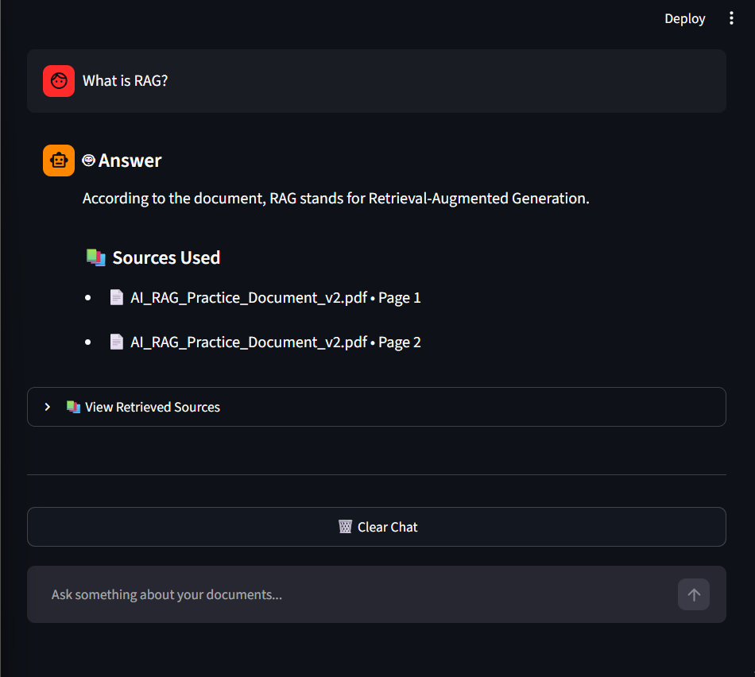
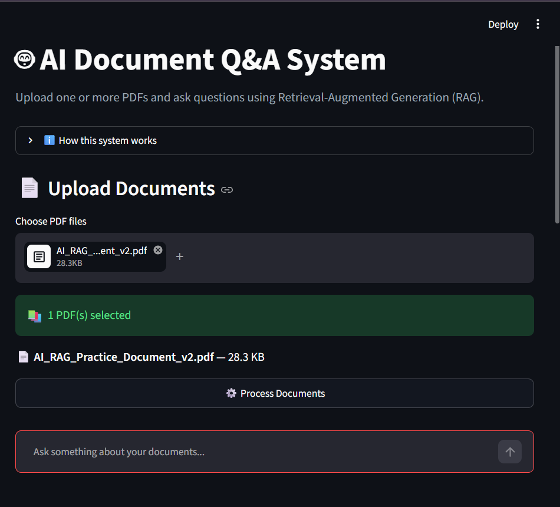

# AI Document Q&A System | RAG-Powered Document Assistant

An AI-powered document assistant that enables users to upload PDF documents, ask natural-language questions, and receive context-aware answers grounded in the content of their files.

Built with **Python, Streamlit, Ollama, Llama 3.2, and ChromaDB**, this project demonstrates how Retrieval-Augmented Generation (RAG) can make local AI models useful for document-based question answering.
## Application Preview

### AI Answer and Source Citations



### PDF Upload and Processing




## Overview

Finding specific information in lengthy documents can be time-consuming. This project simplifies that process by combining semantic search with a locally running language model.

Users upload one or more PDF files, enter a question, and receive an answer generated from relevant document passages. The application also displays retrieved sources, including document names and page numbers, so users can check the supporting information.

## Key Features

* **Multiple PDF Uploads:** Work with more than one PDF document.
* **Retrieval-Augmented Generation:** Ground answers in retrieved document content.
* **Semantic Search:** Retrieve relevant passages using vector embeddings.
* **Document Processing:** Split extracted text into smaller chunks for retrieval.
* **Local AI Models:** Use Ollama to run the language model and embedding model locally.
* **Vector Database:** Store and search document embeddings with ChromaDB.
* **Source Citations:** Display source filenames and page numbers.
* **Retrieved Context:** Inspect the document passages returned by the search.
* **Relevance Scores:** View the application's retrieval relevance estimates.
* **Interactive Chat Interface:** Ask questions through a Streamlit application.
* **Session Controls:** Clear the chat or start a new document session.
* **Context-Based Responses:** Instruct the model to avoid unsupported answers when the uploaded documents do not provide sufficient information.

## Architecture

```text
             PDF Documents
                   |
                   v
           Document Loading
                   |
                   v
            Text Chunking
                   |
                   v
          Generate Embeddings
                   |
                   v
             ChromaDB
          Vector Database
                   |
                   v
            User Question
                   |
                   v
          Semantic Retrieval
                   |
                   v
          Relevant Text Chunks
                   |
                   v
           Ollama + Llama 3.2
                   |
                   v
          Answer + Source Details
```

## Technology Stack

| Technology       | Purpose                                 |
| ---------------- | --------------------------------------- |
| Python           | Application logic                       |
| Streamlit        | Interactive web interface               |
| Ollama           | Local model execution                   |
| Llama 3.2        | Answer generation                       |
| Nomic Embed Text | Text embeddings                         |
| ChromaDB         | Vector storage and retrieval            |
| LangChain        | AI and document-processing integrations |
| PyPDF            | PDF text extraction                     |

## Project Structure

```text
AI-Document-QA-System/
│
├── app.py              # Streamlit application
├── rag.py              # Retrieval and answer generation
├── vectorstore.py      # Vector database operations
├── chunker.py          # Text chunking
├── embedding.py        # Embedding-related operations
├── loader.py           # Document loading utilities
├── requirements.txt    # Python dependencies
├── README.md           # Project documentation
└── .gitignore          # Excluded files
```

## Getting Started

### Prerequisites

Install the following before running the project:

* Python 3.10 or newer, compatible with the project's dependencies
* [Ollama](https://ollama.com/)
* [Git](https://git-scm.com/)

### 1. Clone the Repository

Replace `YOUR-USERNAME` with your GitHub username after publishing the repository.

```bash
git clone https://github.com/YOUR-USERNAME/AI-Document-QA-System.git
cd AI-Document-QA-System
```

### 2. Create a Virtual Environment

```bash
python -m venv venv
```

Activate it on Windows PowerShell:

```powershell
.\venv\Scripts\Activate.ps1
```

### 3. Install Dependencies

```bash
pip install -r requirements.txt
```

### 4. Download the Required Models

Open a terminal and run:

```bash
ollama pull llama3.2:3b
ollama pull nomic-embed-text:latest
```

Ensure Ollama is running before launching the application.

### 5. Launch the Application

From the project directory, run:

```bash
streamlit run app.py
```

Open the local URL displayed in the terminal, then upload your PDF documents and start asking questions.

## Example Use Cases

* Extract key information from study notes.
* Find definitions and explanations in course material.
* Summarize important concepts from uploaded documents.
* Search across multiple PDFs without manually reading every page.
* Locate the source passages that support an answer.

## Source Transparency

The application presents retrieved document passages alongside source information, such as the PDF filename and page number.

This helps users inspect the context used by the system. However, retrieval scores are estimates, and generated answers should still be checked against the original documents.

## Design Principles

* **Local-first inference:** Uses locally running Ollama models rather than requiring an OpenAI API key.
* **Document-grounded answers:** Uses retrieved context to guide answer generation.
* **Traceability:** Shows the sources returned by document retrieval.
* **Modular code:** Separates the application interface, retrieval logic, and vector database operations.

Local execution still depends on the installed models, system resources, and compatible Python packages.

## Current Limitations

* Answer quality depends on the quality and content of uploaded PDFs.
* Scanned PDFs may require OCR if they do not contain extractable text.
* Local model speed depends on available hardware and memory.
* Retrieved passages and relevance scores do not guarantee that every answer is correct.

## Future Improvements

* Support for additional document formats.
* Improved retrieval and reranking.
* Downloadable answers with source references.
* Persistent conversation history.
* User authentication and multi-user support.
* Deployment for remote access.
* Automated evaluation of retrieval quality and answer accuracy.

## Author

**Sania Munir**
BSAI Student | AI & Machine Learning Enthusiast

## License

This project is intended for educational and portfolio purposes. A formal open-source license can be added if the project is distributed for reuse.

---

*Built to explore practical applications of Retrieval-Augmented Generation and locally hosted AI models.*
